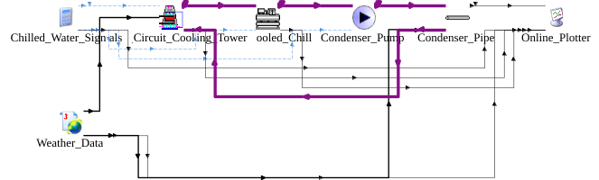
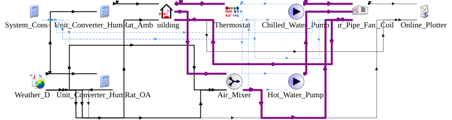
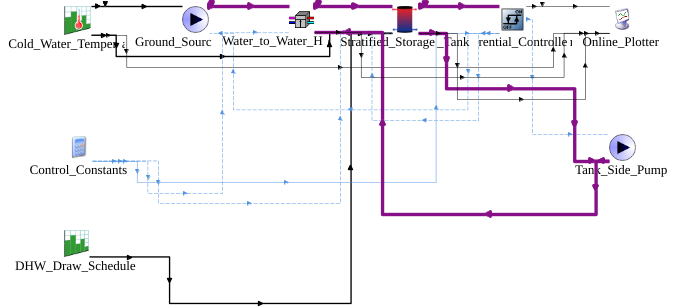
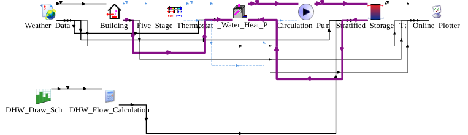
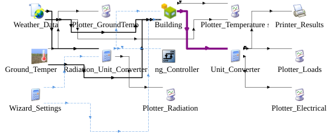
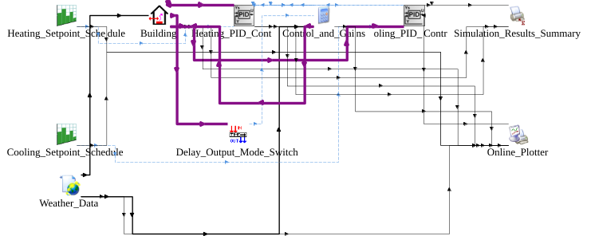
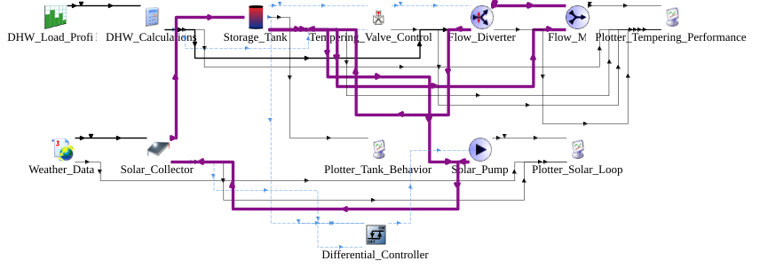
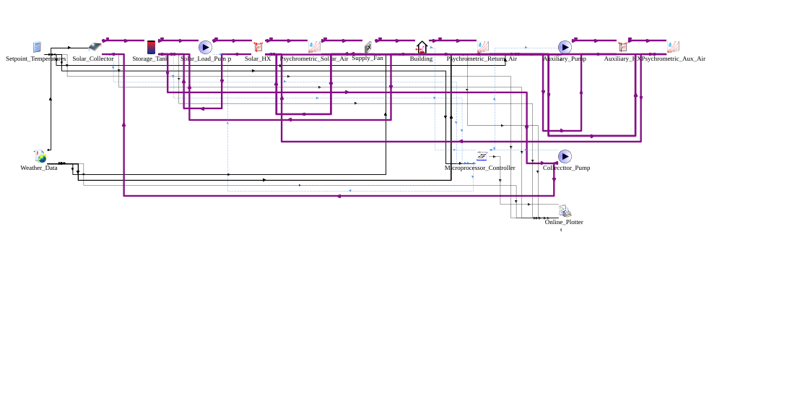
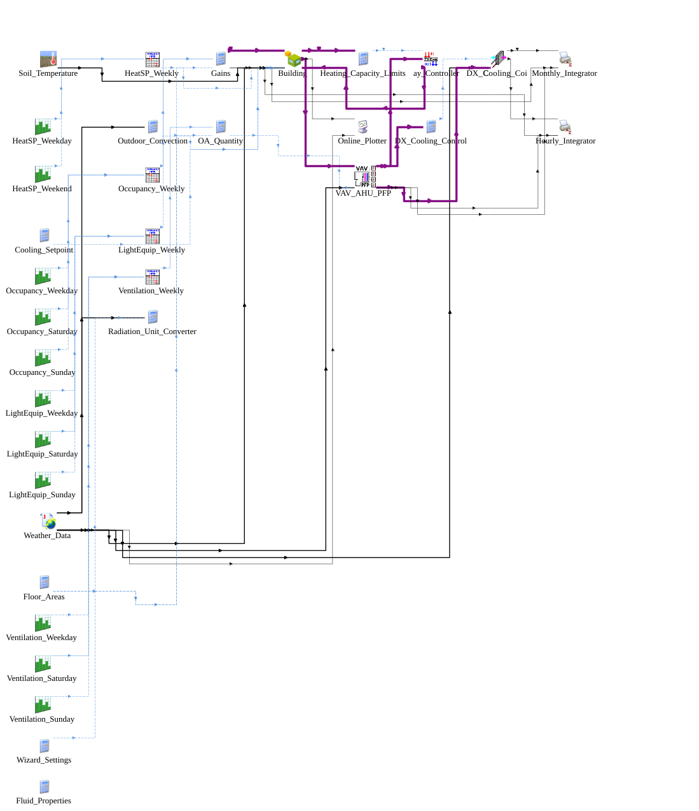
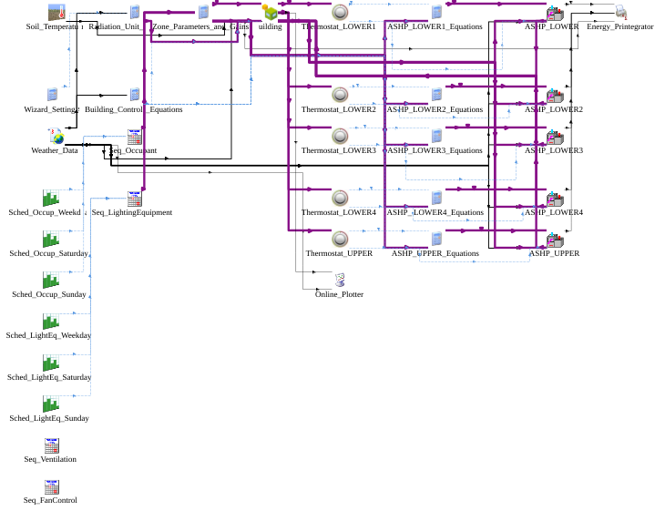

# DKE-ABEM
A domain knowledge-enhanced multi-agent collaborative framework powered by LLMs for automated system-level building energy modeling

Fig. 1. Overall architecture of DKE-ABEM

Fig. A1. Generated model for task01: coupled water-cooled chiller and closed-circuit cooling tower system

Fig. A2. Generated model for task02: four-pipe fan-coil air-conditioning system for a single-zone building

Fig. A3. Generated model for task03: water-to-water heat pump domestic hot water system

Fig. A4. Generated model for task04: air-to-water heat pump system for combined space cooling and domestic hot water

Fig. A5. Generated model for task05: thermal performance simulation of a two-story office building

Fig. A6. Generated model for task06: PID-controlled heating and cooling system for a single-zone building

Fig. A7. Generated model for task07: solar domestic hot water system controlled by a tempering valve

Fig. A8. Generated model for task08: solar-assisted air heating system (multi-mode control)

Fig. A9. Generated model for task09: VAV air-conditioning system combining PFP terminals, DX cooling, and electric reheat

Fig. A10. Generated model for task10: zonal split air-source heat pump system for a multi-zone office building

