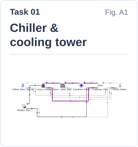
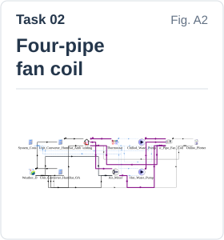
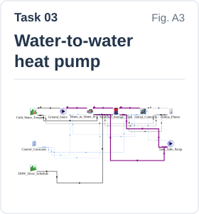
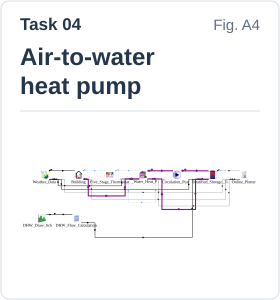
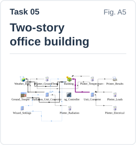
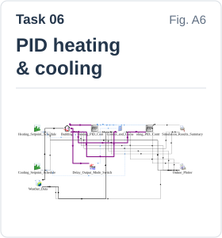
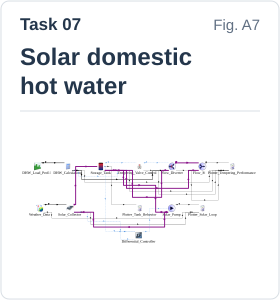
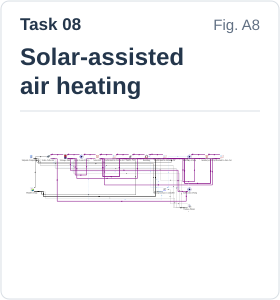
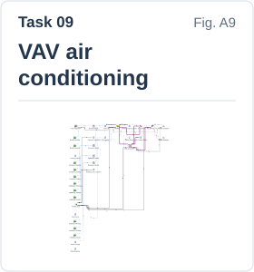
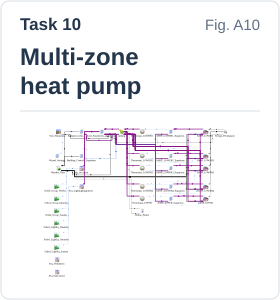

<h1 align="center">DKE-ABEM</h1>

  <strong>Domain knowledge-enhanced building energy modeling</strong> 
  A multi-agent collaborative framework powered by LLMs for automated system-level modeling

  <a href="#overall-architecture">Overall architecture</a> &nbsp; · &nbsp;
  <a href="#generated-models">Explore 10 tasks</a> &nbsp; · &nbsp;
  <a href="#figure-reference">Figure reference</a>

---

### Overall architecture · Fig. 1

  

Fig. 1. Overall architecture of DKE-ABEM

---

### Generated models

Select a card to view the model diagram, or choose **View full thread** to explore its interactive execution trace.

<table align="center">
  <tr>
    <td align="center" valign="top" width="20%">
       
      <a href="https://mengql01.github.io/DKE-ABEM/task01/" title="Open the interactive execution trace for Task 01">View full thread</a>
    </td>
    <td align="center" valign="top" width="20%">
       
      <a href="https://mengql01.github.io/DKE-ABEM/task02/" title="Open the interactive execution trace for Task 02">View full thread</a>
    </td>
    <td align="center" valign="top" width="20%">
       
      <a href="https://mengql01.github.io/DKE-ABEM/task03/" title="Open the interactive execution trace for Task 03">View full thread</a>
    </td>
    <td align="center" valign="top" width="20%">
       
      <a href="https://mengql01.github.io/DKE-ABEM/task04/" title="Open the interactive execution trace for Task 04">View full thread</a>
    </td>
    <td align="center" valign="top" width="20%">
       
      <a href="https://mengql01.github.io/DKE-ABEM/task05/" title="Open the interactive execution trace for Task 05">View full thread</a>
    </td>
  </tr>
  <tr>
    <td align="center" valign="top" width="20%">
       
      <a href="https://mengql01.github.io/DKE-ABEM/task06/" title="Open the interactive execution trace for Task 06">View full thread</a>
    </td>
    <td align="center" valign="top" width="20%">
       
      <a href="https://mengql01.github.io/DKE-ABEM/task07/" title="Open the interactive execution trace for Task 07">View full thread</a>
    </td>
    <td align="center" valign="top" width="20%">
       
      <a href="https://mengql01.github.io/DKE-ABEM/task08/" title="Open the interactive execution trace for Task 08">View full thread</a>
    </td>
    <td align="center" valign="top" width="20%">
       
      <a href="https://mengql01.github.io/DKE-ABEM/task09/" title="Open the interactive execution trace for Task 09">View full thread</a>
    </td>
    <td align="center" valign="top" width="20%">
       
      <a href="https://mengql01.github.io/DKE-ABEM/task10/" title="Open the interactive execution trace for Task 10">View full thread</a>
    </td>
  </tr>
</table>

---

<strong>Figure reference · Fig. A1–A10</strong>

Fig. A1. Generated model for task01: coupled water-cooled chiller and closed-circuit cooling tower system

Fig. A2. Generated model for task02: four-pipe fan-coil air-conditioning system for a single-zone building

Fig. A3. Generated model for task03: water-to-water heat pump domestic hot water system

Fig. A4. Generated model for task04: air-to-water heat pump system for combined space cooling and domestic hot water

Fig. A5. Generated model for task05: thermal performance simulation of a two-story office building

Fig. A6. Generated model for task06: PID-controlled heating and cooling system for a single-zone building

Fig. A7. Generated model for task07: solar domestic hot water system controlled by a tempering valve

Fig. A8. Generated model for task08: solar-assisted air heating system (multi-mode control)

Fig. A9. Generated model for task09: VAV air-conditioning system combining PFP terminals, DX cooling, and electric reheat

Fig. A10. Generated model for task10: zonal split air-source heat pump system for a multi-zone office building

